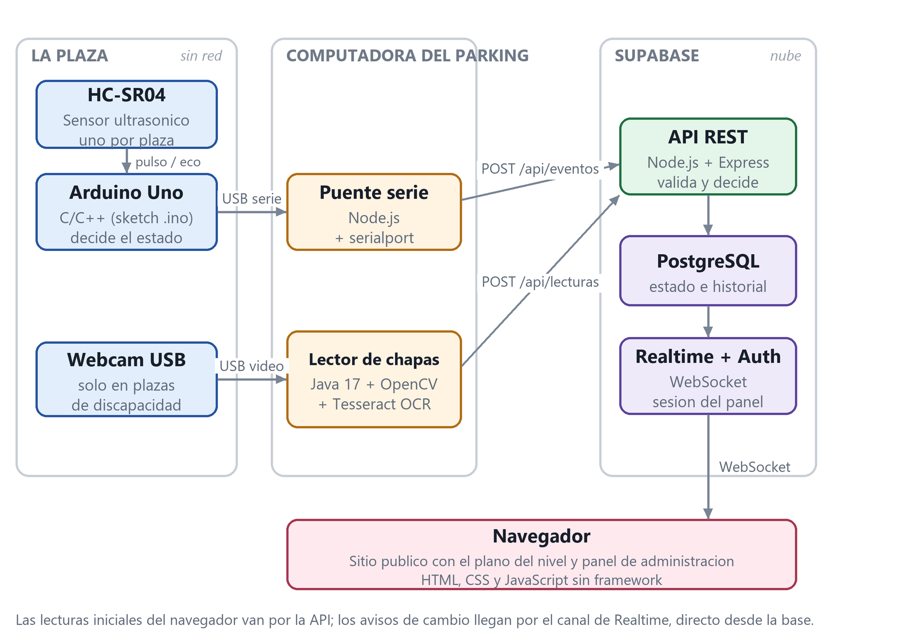

# ParkEx

**Monitoreo en tiempo real de estacionamientos privados, con verificación
automática de las plazas reservadas para personas con discapacidad.**

[](https://doi.org/10.5281/zenodo.23377101)


ParkEx muestra sobre el plano de cada nivel del parking qué plazas están libres
u ocupadas, y se actualiza solo en cuanto un auto entra o sale. En las plazas
reservadas, una cámara lee la matrícula y comprueba si el vehículo lleva el
distintivo de discapacidad; si no lo lleva, genera una alerta para que la revise
una persona.

---

## Reconocimiento

ParkEx se presentó en la **III Semana Académica de Ingeniería en Logística** de
la Universidad Tecnológica del Uruguay (UTEC), Instituto Tecnológico Regional
Norte, realizada del 6 al 8 de octubre de 2026 en Rivera.

En esa instancia el proyecto obtuvo los premios a **Mejor exposición** y a
**Excelencia académica**.

El resumen del trabajo está publicado en el libro de resúmenes del evento:

> Castro, J., Ligüera, C., Bazzano, L., Duarte, F. y Facchin, L. (2026).
> *ParkEx: monitoreo en tiempo real de la ocupación de posiciones y verificación
> automatizada de plazas reservadas mediante sensórica y visión por
> computadora.* En *Libro de resúmenes de la III Semana Académica de Ingeniería
> en Logística*. Universidad Tecnológica del Uruguay.
> https://doi.org/10.5281/zenodo.23377101

---

## El problema

Dentro de un estacionamiento privado (un edificio, un shopping, un sanatorio)
los conductores recorren niveles enteros buscando un lugar libre. Al mismo
tiempo, las plazas reservadas para personas con discapacidad suelen quedar
ocupadas por vehículos sin permiso, y el operador no tiene forma práctica de
enterarse.

ParkEx ataca las dos cosas con hardware de bajo costo:

- **Un sensor ultrasónico por plaza** detecta si hay un auto.
- **Una cámara solo en las plazas reservadas** lee la chapa cuando el sensor
  avisa que alguien estacionó.
- **Un sitio web** muestra el plano en vivo y un panel de administración recibe
  las alertas.

## Características

- **Plano en tiempo real.** El plano SVG de cada nivel se repinta en el
  momento en que cambia una plaza, sin recargar la página.
- **Verificación de plazas reservadas.** Lectura de matrícula por OCR, con
  varias fotos por evento y consenso entre lecturas para descartar errores.
- **Sin padrones externos.** El permiso se reconoce por el distintivo `DI`
  impreso en la propia chapa uruguaya.
- **El sistema no sanciona.** Una lectura dudosa queda como *no
  verificable* y nunca genera alerta; las alertas van a revisión humana.
- **Privacidad por diseño.** La matrícula nunca se guarda en texto: sale de
  la máquina del parking solo como HMAC-SHA256, y las imágenes se procesan en
  memoria y se descartan.
- **Sensores sin credenciales.** El Arduino de la plaza no tiene WiFi ni
  token; toda la conectividad vive en una sola computadora que hace de puente.

## Cómo funciona



1. El **Arduino** mide la distancia con el HC-SR04, decide si la plaza está
   ocupada y lo escribe por el puerto serie.
2. El **puente serie** (Node.js) traduce cada línea en una petición a la API.
3. La **API** (Express) registra el evento en **Supabase**, y Supabase Realtime
   avisa a los navegadores conectados.
4. Si la plaza es reservada, el **lector de matrículas** (Java + OpenCV +
   Tesseract) toma varias fotos, lee la chapa, comprueba el distintivo y reporta
   solo el hash y el resultado.
5. Si el vehículo no lleva distintivo, aparece una **alerta** en el panel.

## Stack

| Parte | Tecnología |
|---|---|
| Sitio web y panel | HTML, CSS y JavaScript sin framework, plano en SVG |
| API | Node.js + Express |
| Base de datos, login y tiempo real | Supabase (PostgreSQL, Auth, Realtime) |
| Lector de matrículas | Java 17, OpenCV, Tesseract OCR |
| Puente serie | Node.js + `serialport` |
| Sensor | Arduino Uno + HC-SR04 |

## Estructura del repositorio

```
ParkEx/
├── web/        Sitio público (plano) y panel de administración
├── api/        API REST en Node.js + Express
├── gateway/    Puente entre el puerto serie del Arduino y la API
├── vision/     Lector de matrículas en Java
├── firmware/   Sketch del sensor para Arduino Uno
├── db/         Esquema, funciones y políticas de seguridad
├── Tinkercad/  Diagramas del circuito
└── docs/       Documento de diseño y figuras
```

## Documentación

| Documento | Contenido |
|---|---|
| [docs/DISENO.md](docs/DISENO.md) | Arquitectura, decisiones de diseño, modelo de datos, API, seguridad, hardware, plan de fases y riesgos |
| [CAMBIOS.md](CAMBIOS.md) | Registro de cambios: qué se hizo en cada commit y qué quedó pendiente |
| [AGENTS.md](AGENTS.md) | Instrucciones para asistentes de IA que trabajen sobre el repo |

## Estado

Prototipo funcional. El circuito completo se probó de punta a punta sobre una
plaza real: el sensor reporta la ocupación, la cámara se dispara sola, lee la
chapa, comprueba el distintivo y la alerta aparece en el panel sin recargar la
página.

## Equipo

Proyecto desarrollado por estudiantes de Tecnologías de la Información del
ITSP (Paysandú, Uruguay).

**Autores:** Joaquín Castro, Catalina Ligüera, Luciano Bazzano, Facundo Duarte y
Lucio Facchin.

**Docentes tutores:** Facundo Rubil y Federico Fagúndez.

## Cómo citar

```bibtex
@inproceedings{parkex2026,
  author    = {Castro, Joaquin and Ligüera, Catalina and Bazzano, Luciano and
               Duarte, Facundo and Facchin, Lucio},
  title     = {ParkEx: monitoreo en tiempo real de la ocupación de posiciones y
               verificación automatizada de plazas reservadas mediante
               sensórica y visión por computadora},
  booktitle = {Libro de resúmenes de la III Semana Académica de Ingeniería en
               Logística},
  publisher = {Universidad Tecnológica del Uruguay},
  address   = {Rivera, Uruguay},
  year      = {2026},
  doi       = {10.5281/zenodo.23377101}
}
```
